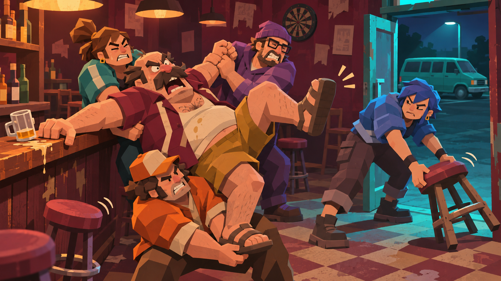
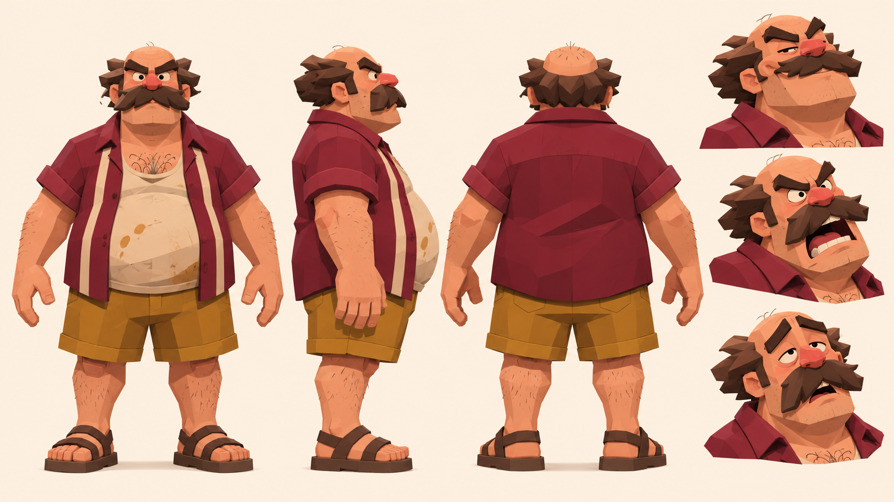
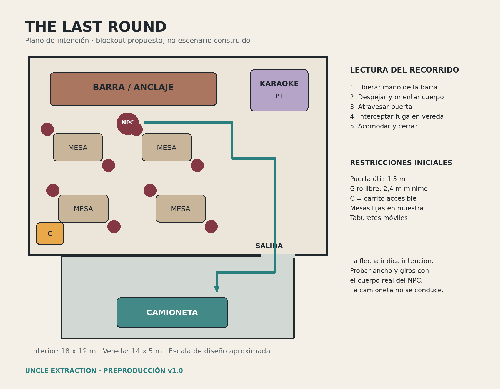
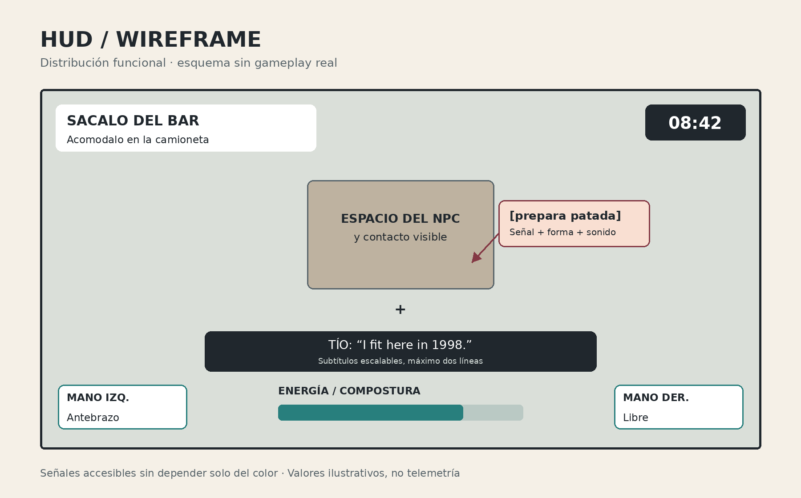

# UNCLE EXTRACTION
## 01. Identidad visual y referencia principal

**Biblia de arte, interfaz y audio | Versión 1.0 | 15 de noviembre de 2026**

La dirección es una comedia 3D estilizada de mala noche en un bar: cuerpos anchos, siluetas asimétricas, manos grandes, ropa gastada y materiales mates. El acabado debe verse intencional y consistente. La torpeza pertenece a los personajes y la ficción; los contornos, señales y estados interactivos necesitan precisión.

La imagen entregada explora el contraste entre un tío obstinado y cuatro amigos ocupados en tareas diferentes. La barra es cálida y la salida azul verdosa. El usuario debe identificar al sujeto principal a primera vista. Los personajes no se camuflan entre la utilería. La composición funciona como referencia de atmósfera y marketing temprano, no como promesa de fidelidad visual final.

Evitar hiperrealismo, piel brillante, filtros sucios que oculten señales, iluminación de terror constante y docenas de pequeñas piezas físicas. Una nariz roja y una camisa abierta comunican más que texturas de poros. La iluminación debe seguir siendo legible en calidad baja y sin sombras dinámicas.

El nombre UNCLE EXTRACTION es provisional. No se ha comprobado marca, dominio ni disponibilidad de título comercial. El logotipo final se diseña después de esa comprobación; el prototipo puede usar tipografía de sistema con licencia apropiada. La marca no necesita incluir insultos para comunicar el tono adulto.

## 02. Personaje principal: forma, vestuario y expresiones

El tío tiene torso ancho, piernas relativamente cortas, bigote voluminoso y cejas que se leen a distancia. Lleva camisa bordó abierta, musculosa crema manchada, short mostaza y sandalias. La ropa aporta asas reconocibles en hombros y cintura; los sockets de agarre deben coincidir con esas zonas. No usar accesorios que escondan los brazos justo cuando prepara un golpe.

Esta lámina ofrece vistas conceptuales aproximadas y tres expresiones. No es un turnaround técnico registrado ni garantiza medidas idénticas entre vistas. El modelador debe resolver proporciones consistentes, volumen posterior, articulaciones y topología antes de usarla como referencia de producción.

Expresiones prioritarias: soberbia relajada, sospecha al ser agarrado, esfuerzo previo al golpe, indignación tras fallar, agotamiento y falsa cooperación. La cara puede comenzar con mandíbula y cejas animables o un pequeño conjunto de blendshapes. No necesita captura facial. El bigote no tapa la apertura de boca por completo.

El volumen del cuerpo no determina invulnerabilidad ni es el único chiste. Su personalidad aparece en la manera de agarrar la barra, señalar al dueño inexistente y exigir trato premium. El rig debe permitir esas poses sin que hombros o codos desaparezcan dentro del torso.

Objetivos de producción iniciales: 12.000 a 20.000 triángulos para el NPC, una o dos hojas de textura de hasta 2048 px y once cuerpos físicos principales. Son presupuestos propuestos, no especificaciones de un archivo ya entregado. El concepto no trae malla, rig, UV, materiales Unity ni animaciones.

## 03. Amigos, siluetas y lectura del escenario

Los cuatro amigos comparten rig compatible pero tienen siluetas y colores diferenciados: chaqueta verde azulada, campera naranja, gorro violeta y ropa azul. La personalización posterior conserva tamaño funcional, altura de manos y cápsula. Un sombrero nunca aumenta la hitbox ni bloquea una señal importante.

Cada jugador se identifica por nombre, icono y color; el color solo no basta. Desde primera persona se muestran antebrazos simplificados que coinciden con la ropa elegida. Las manos de otros jugadores deben apuntar al socket real para que se entienda quién está sosteniendo qué.

| Elemento | Forma y lectura | Interacción |
| --- | --- | --- |
| Barra | Superficie pesada de madera, borde claro | Anclaje fijo identificable. |
| Silla / taburete | Patas gruesas y asiento contrastado | Prop móvil con puntos simples. |
| Mesa | Volumen estable y patas amplias | Obstáculo fijo en primera muestra. |
| Carrito | Plataforma baja, ruedas grandes, manillar | Ayuda de transporte, especialmente individual. |
| Puerta | Marco contrastado, manija visible | Bisagra limitada y bloqueo comprobable. |
| Camioneta | Silueta sencilla, zona interior iluminada | Volumen de extracción y cierre. |

El bar parece usado y barato, con carteles ficticios, lámparas cálidas y una esquina de karaoke. Los objetos del fondo se agrupan visualmente. Un objeto interactivo recibe contorno al enfocarlo; no se aplica un brillo permanente a toda la sala. Evitar marcas reales o carteles copiados de fotografías sin derechos.

El diseño de nivel distingue tres familias: arquitectura fija, objetos manipulables y decoración. Cada familia tiene una pauta visual consistente, además del contorno contextual. El carrito debe verse útil antes de leer un tutorial. La puerta de salida y el vehículo mantienen un contraste suficiente desde los principales puntos del recorrido.

## 04. Paleta, materiales e iluminación

| Uso | Color propuesto | Hexadecimal |
| --- | --- | --- |
| Fondo oscuro / sombras | Carbón cálido | #191D22 |
| Identidad del tío | Bordó gastado | #843844 |
| Luz interior / acentos | Ámbar | #E9A84A |
| Ruta de salida | Verde azulado | #3CA6A0 |
| Texto claro | Crema | #F3E7CF |
| Señal de peligro | Coral | #EE735B |
| Compañero alternativo | Violeta | #8267B0 |

Los valores son una propuesta visual, no un requisito de usar exactamente cada píxel. Las señales de peligro también usan animación, forma y sonido. Un jugador con dificultad para distinguir rojo/verde tiene que reconocer preparación y apertura de todas formas.

Materiales de personaje: colores grandes, rugosidad alta, suciedad pintada en pocas zonas y contraste de valor en manos/cara. Las telas no necesitan simulación completa. Una pequeña animación del borde de camisa puede agregarse después si no estorba el agarre.

Materiales de entorno: madera, cuero artificial, metal pintado y piso de baldosas. Una textura de detalle compartida puede aportar desgaste. Los cristales de fondo se representan con materiales sencillos; transparencia y reflejos complejos son opcionales. El líquido de vasos puede resolverse con una malla pequeña o efecto simple; no requiere simulación de fluidos.

Iluminación: interior ámbar con luz general suficiente y salida verde azulada. Emplear iluminación horneada donde sea estable. Reservar sombras dinámicas para personajes y pocos objetos importantes. El escenario conserva lectura sin bloom, con postprocesado mínimo y con brillo configurable. La variante de marihuana no se comunica mediante una distorsión permanente que impida jugar.

Se prepara una escena de prueba con gris neutro, luces del bar y luces de exterior para revisar cada asset en tres condiciones. Antes de aprobar un material, observarlo a tamaño de juego y a distancia de gameplay; el render de estudio no es suficiente.

## 05. Animación y lenguaje de los ataques

La animación debe dar información antes de producir caos. Cada ataque tiene pose de preparación, acción breve y recuperación distinta. La forma inicial se exagera más que la velocidad final. No se acelera tanto la señal en Difícil que deje de ser visible.

| Clip | Intención y requisito |
| --- | --- |
| Idle / seated | Confianza y balanceo leve, sin mover sockets de forma impredecible. |
| Protest | Mira al jugador y protege su lugar. |
| Anchor left / right | Mano pegada al anclaje real, con corrección de alcance. |
| Slap windup / active / recover | Hombro levantado y arco lateral legible. |
| Push windup / active / recover | Pies apoyados y palmas hacia atrás antes del empuje. |
| Kick windup / active / recover | Una rodilla flexionada; indicar pierna usada. |
| Shake windup / active / recover | Inhalación visible y cuerpo que se tensa. |
| Exhausted | Hombros caídos y respiración, señal de oportunidad. |
| Fake cooperate | Sonrisa y dos pasos de colaboración antes de nueva decisión. |
| Escape walk | Marcha decidida pero torpe, limitada por física. |
| Secured | Se acomoda, protesta una última vez y termina la ronda. |

Los clips se especifican con duración editable. La primera implementación puede usar poses procedurales o animaciones muy simples. El controlador físico resuelve contacto y sostén; la animación no fuerza al personaje a atravesar una pared para terminar un gesto.

Para el NPC, usar cuerpo físico reducido y una malla que siga su pose. Los huesos visuales secundarios pueden suavizar el resultado. Si el modelo usa rig humanoide, verificar que proporciones exageradas no rompan retargeting. Un rig genérico también es válido si el pipeline queda documentado.

Para jugadores, caminar, empujar, tirar, ayudar, tropiezo y levantada deben combinarse con las manos ocupadas. La cámara de caída se diseña como presentación controlada. No copiar la rotación de la cabeza física directamente al punto de vista.

El animador y programador aprueban juntos un ataque: señal comprensible sin UI, coincidencia con volumen de contacto, una sola reacción por objetivo y recuperación visible. La sincronización se vuelve a revisar en cliente remoto.

## 06. Plano de intención del bar

El plano distingue barra, mesas, karaoke, pasillo, salida y vehículo. Es una guía de blockout y no sustituye pruebas de recorrido. Las dimensiones definitivas se ajustan en Unity con el tamaño real del NPC, la cámara y cuatro jugadores. La ruta principal debe ofrecer al menos dos formas de orientar el transporte en la zona de mesas.

## 07. Interfaz y accesibilidad visual

El HUD propone objetivo en esquina superior izquierda, reloj cuando exista en la derecha, dos manos y energía en el borde inferior. La señal del ataque aparece junto al miembro pertinente, con alternativa de subtítulo descriptivo. Se dejan libres centro y zona de contacto para observar agarres.

Menús con tipografía sans serif legible y títulos pesados. El tono puede aparecer en subtítulos secundarios: «Professional Bad Decisions». Los botones principales conservan «Jugar», «Con amigos», «Opciones» y «Salir». La legibilidad tiene prioridad sobre imitar una interfaz de bar.

Escalas a revisar: 1080p como objetivo inicial, 720p para comprobar lectura y formatos ultrapanorámicos sin estirar paneles. El texto de diálogo debe permitir al menos dos líneas cómodas y un control de tamaño. Un cambio de idioma no debe desplazar el indicador de las manos fuera de pantalla.

Los wireframes son entregables de diseño exactos elaborados con herramientas gráficas, no imágenes generadas que aparenten una interfaz funcional. Cada uno incluye leyenda de su estado conceptual.

## 08. Audio, voces y mezcla

El paisaje sonoro tiene música de bar ficticia, ambiente bajo, pasos, muebles, tela bajo tensión, protestas y señales. La música nunca tapa la preparación de un ataque. El sonido del empujón puede ser exagerado y seco; no hace falta audio de lesiones realistas.

Grupos de mezcla: Master, Music, Ambience, NPC Voice, Gameplay SFX y Cues. Las voces ordinarias bajan de prioridad ante Cues. El jugador puede bajar insultos o voces sin perder señales mediante subtítulos descriptivos y efectos específicos.

Presupuesto inicial propuesto: 12 a 20 variaciones de impacto agrupadas por material, 6 de esfuerzo, 8 de locomoción y una primera selección de 20 a 30 líneas de voz a partir del catálogo. El CSV de guion incluye más texto para selección; no implica que existan grabaciones. Las voces finales requieren interpretación consistente y derechos de uso comercial.

El tío habla inglés coloquial con confianza exagerada. Se puede grabar con actor o una solución de voz licenciada que se revise expresivamente. No imitar una celebridad ni construir la identidad a partir de una voz reconocible ajena. Los archivos de voz se entregan en WAV mono limpio para importación; los archivos de música pueden ser estéreo. El motor define compresión final después de medir tamaño y calidad.

Reglas espaciales: la voz sale del NPC, los impactos de su contacto y las señales críticas mantienen presencia suficiente aunque el jugador mire al otro lado. La mezcla evita sumas explosivas cuando caen varias sillas. Las frases repetidas se limitan con cooldown y memoria reciente.

La voz de proximidad de jugadores es opcional posterior. El prototipo debe ser divertido usando Discord, conversación externa o marcadores. No se inicia captura de micrófono por sorpresa. Si se implementa, se ofrece activación clara y control de silencio, sin grabación persistente por defecto.

## 09. Producción de imágenes y assets para el juego

El paquete entrega dos conceptos raster y dos esquemas funcionales. Cada concepto incluye prompt en art/PROMPTS_IMAGENES.md y se produjo con generación de imágenes integrada. Su uso aquí es preproducción. Para convertir la intención en juego se necesitan mallas, rig, clips, materiales, prefabs, colisionadores y pruebas de importación.

Flujo recomendado de personaje: fijar proporciones; modelar blockout; aprobar silueta en cámara; probar rig y once cuerpos; realizar topología y UV; texturizar; producir un ataque; integrarlo y probar red; recién después completar expresiones y clips. Un fallo de rig descubierto al final obliga a rehacer demasiado trabajo.

Flujo de utilería: lista por función; escala; malla simple; pivote; colisionador; material; socket y masa; integración en PhysicsLab. Las puertas necesitan pivote real de bisagra. El carrito necesita volumen estable y un asa que coincida con la interacción. Los props decorativos no heredan físicas por usar un prefab común.

| Archivo entregado | Uso autorizado dentro del paquete | Estado de producción |
| --- | --- | --- |
| 01_key_art_concept.png | Referencia de atmósfera y composición | Concepto generado; no screenshot. |
| 02_uncle_character_reference.png | Referencia de forma, ropa y expresiones | Concepto generado; no rig ni turnaround técnico. |
| 03_bar_layout.png | Esquema espacial para blockout | Plano de intención. |
| 04_hud_wireframe.png | Distribución y lectura del HUD | Wireframe, no interfaz funcional. |
| 05_npc_state_flow.png | Explicación de transiciones clave | Diagrama de ingeniería. |

Los prompts futuros deben describir personaje, cámara, función, restricciones y continuidad. Evitar generar cada prop en un estilo diferente. Una imagen de textura requiere escala y continuidad; un concepto de escena no se aplica directamente como textura del bar.

data/asset_manifest.csv enumera lo que falta producir y sus prioridades. Claude debe usar placeholders claramente nombrados hasta disponer de archivos válidos. Si utiliza un asset de terceros, debe conservar origen y licencia en CREDITS_ASSETS.md; no basta con que sea descargable.

## 10. Tienda, capturas y control de calidad visual

La imagen de tienda futura debe comunicar un cuerpo que se resiste y amigos intentando sacarlo. El título se lee en miniatura. Una pose de agarre con una mano anclada explica el juego mejor que cinco personajes mirando a cámara. Probar recortes antes de fabricar variantes.

La documentación oficial de Steam diferencia cápsulas y capturas de gameplay. Las capturas de tienda deben mostrar el juego; los conceptos de este paquete no se suben como screenshots [S7, S8]. Las medidas de exportación se verifican en las plantillas vigentes de Steam al producir los archivos finales, en lugar de congelar tamaños que podrían cambiar.

Guion propuesto de tráiler: 0 a 3 s, cuatro jugadores arrastrando al tío y mano anclada; 3 a 8 s, señal de golpe y desastre; 8 a 15 s, coordinación y carrito; 15 a 23 s, paso por puerta; 23 a 30 s, falsa victoria y título. Es storyboard de intención: debe filmarse con gameplay real cuando exista, sin anunciar perfiles o modos no implementados.

Checklist de revisión de personaje: misma ropa y proporciones entre vistas; sockets alcanzables; bigote y cara legibles; miembros sin penetraciones graves; manos y pies completos en pose neutra. Checklist de entorno: escala, rutas, pivotes, colisión simplificada, lectura de salida y rendimiento en calidad baja.

Checklist de señales: visibles con cuatro cuerpos, equivalentes de color, subtítulos, contraste y correspondencia temporal con contacto. Checklist de UI: inglés/español, mando, texto grande y estados de error. El objetivo de arte no se considera logrado solo porque una imagen de presentación se vea bien.

El material final de tienda y build conserva un inventario de contenido creado con IA cuando corresponda. La encuesta de Steam consultada se enfoca en contenido que se entrega y consume, como arte, sonido, narrativa o traducciones [S9](https://partner.steamgames.com/doc/gettingstarted/contentsurvey). Se completa según los archivos que realmente queden en la versión publicada, no mediante una declaración genérica de que «se usó IA para todo».
